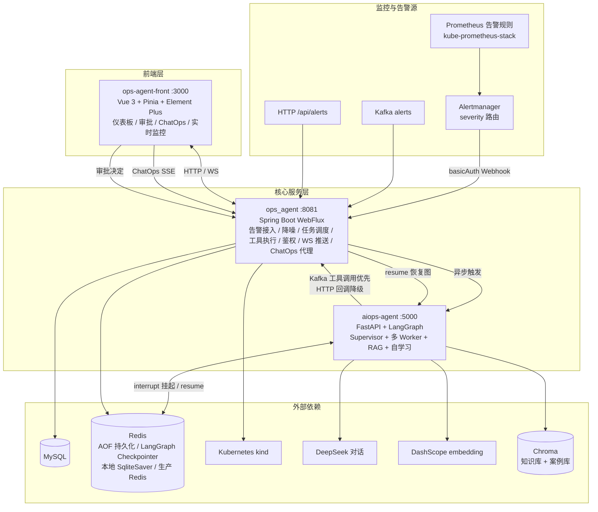
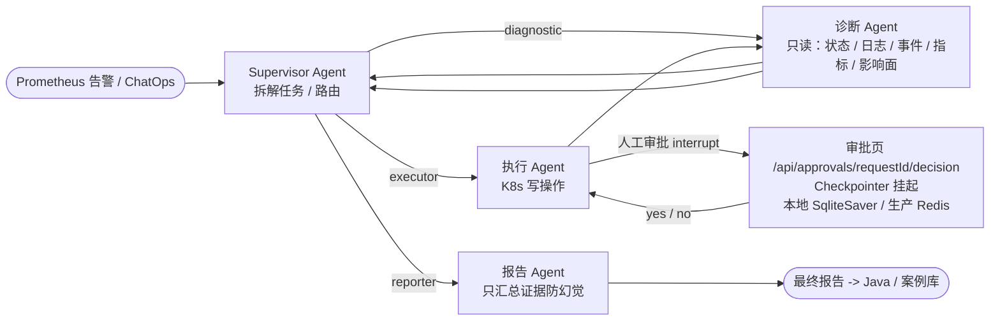
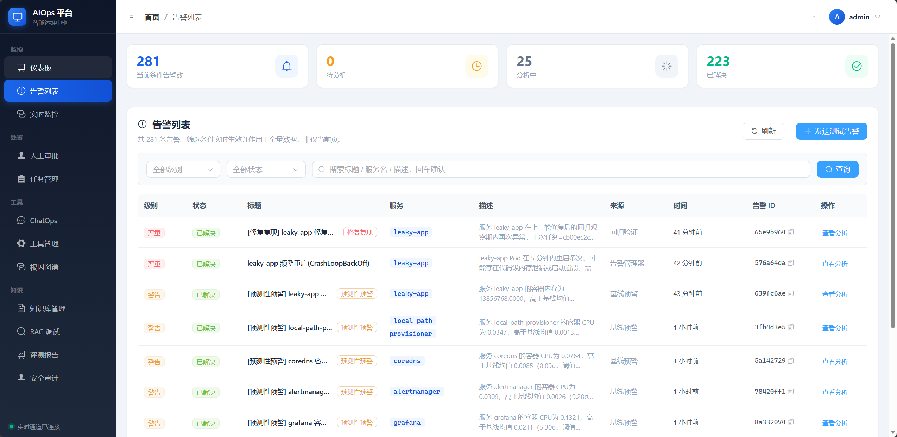
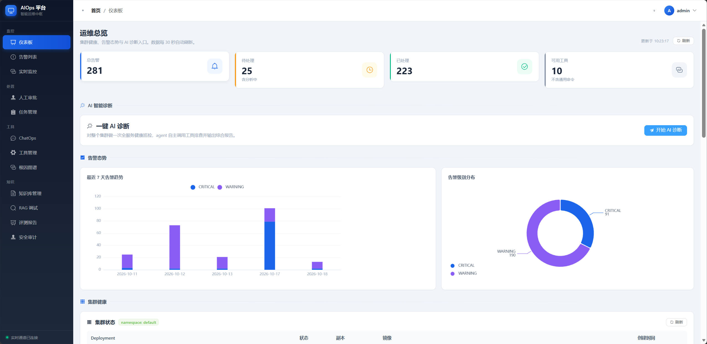
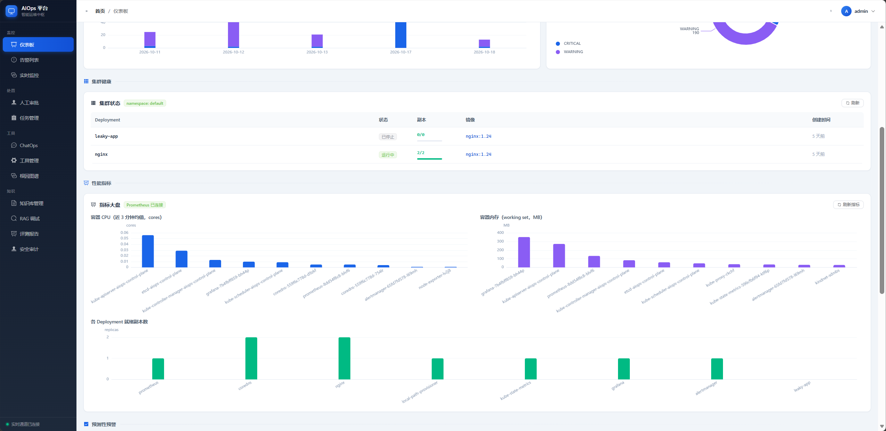
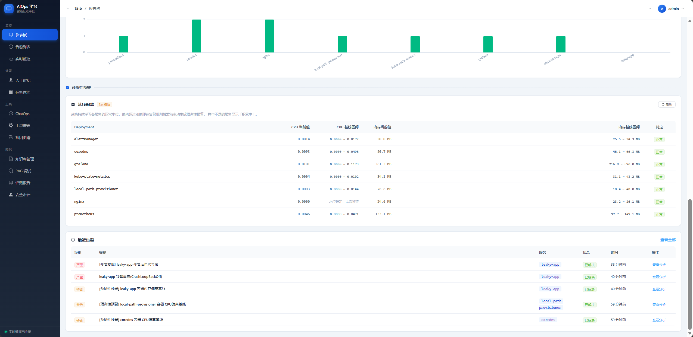
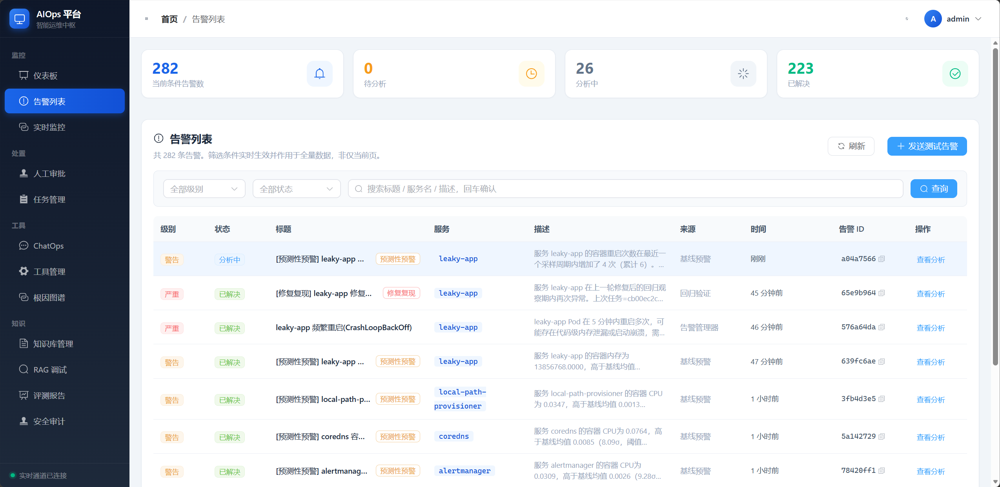
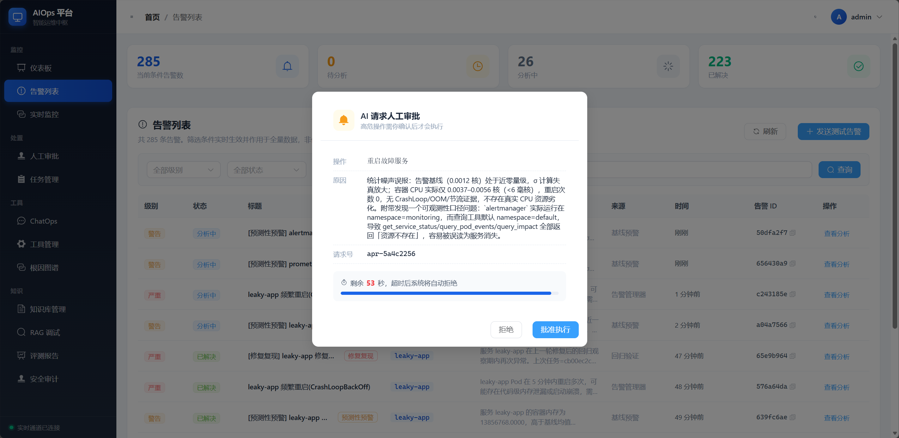
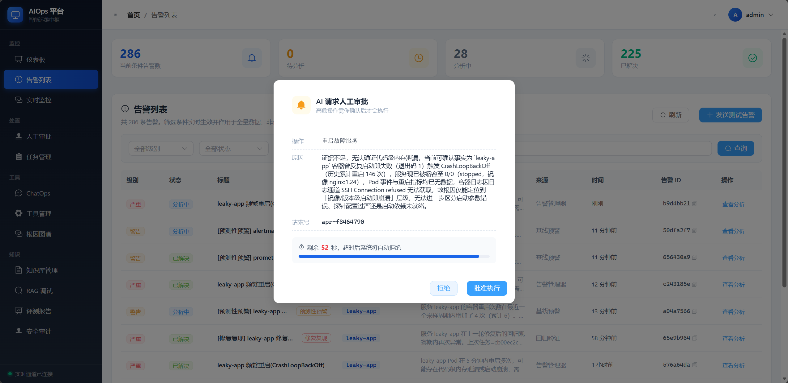
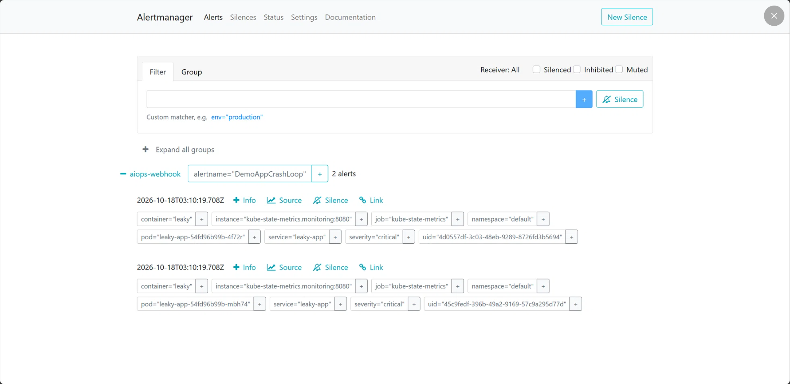

# AIOps 智能运维平台

基于 AI Agent + Spring Boot WebFlux + Vue 3 的智能运维平台，实现告警自动分析、根因定位与修复执行的全链路闭环。

[](https://www.oracle.com/java/)
[](https://spring.io/projects/spring-boot)
[](https://www.python.org/)
[](https://vuejs.org/)
[](LICENSE)

---

## 1. 项目概述

传统运维模式下，告警触发后需要人工登录服务器排查日志、定位根因、手动执行修复，链路长、响应慢、容易出错。本项目构建了一套基于 AI Agent 的智能运维平台，将告警接入、AI 推理、K8s 真实操作、人工审批和实时推送整合为自动化闭环。

**核心逻辑**：真实告警由 Prometheus 自动检测 → Alertmanager 路由 → Webhook 进入平台 → 大模型多轮推理（查 K8s 状态 → 分析日志/事件/指标 → 执行重启/扩容/回滚 → 验证结果）→ 自动输出运维报告并沉淀为历史案例。高危操作在执行前必须经过人工审批，确保安全可控。

**关键指标（本地 kind 演示环境实测）：**

| 指标 | 数值 |
|---|---|
| 单条告警平均节点轮转 | 3~5 个 Worker 节点 |
| 单次推理平均耗时 | 20~60 秒 |
| 工具调用成功率 | 约 95%（K8s 操作类） |
| 人工审批挂起恢复 | LangGraph interrupt() + Checkpointer（本地 SqliteSaver / 生产 Redis Checkpointer），不再有 55s 线程阻塞 |
| 告警到报告端到端耗时 | 30~90 秒 |
| 同源告警降噪比 | 4 条告警 → 1 次分析 |

---

## 2. 整体架构

平台由三个核心模块与七类外部依赖组成。前端通过 HTTP 和 WebSocket 与 Java 中枢通信，Java 异步触发 Python 的 LangGraph 状态图，Python 执行工具时优先走 Kafka 事件驱动（`agent-tool-request` / `agent-tool-result`），异常自动降级回 HTTP 回调；人工审批由 `interrupt()` 挂起图，Java 审批决定后回调 Python 恢复执行。



### LangGraph Multi-Agent 状态图

> 完整设计文档见 [docs/langgraph-multi-agent.md](docs/langgraph-multi-agent.md)。



## 核心模块

| 模块 | 技术栈 | 端口 | 职责 |
|------|--------|------|------|
| ops_agent | Java 21 + Spring Boot WebFlux | 8081 | 平台中枢：告警接入、降噪聚合、任务调度、工具执行、鉴权、WebSocket 推送、ChatOps 流式代理 |
| aiops-agent | Python + FastAPI + LangGraph | 5000 | AI 大脑：Supervisor + 多 Worker 状态图、RAG 检索、历史案例自学习 |
| ops-agent-front | Vue 3 + Pinia + Element Plus | 3000 | 运维管理界面：告警管理、审批管理、任务监控��工具演练、ChatOps 对话 |

## 外部依赖

| 依赖 | 接入模块 | 通信/协议 | 用途 |
|------|---------|-----------|------|
| MySQL | ops_agent | JDBC | 告警、审批、用户数据持久化 |
| Redis | ops_agent | Redis 读写 | 任务状态、审批队列、Webhook 幂等去重、降噪聚合窗口 |
| Kafka | ops_agent / aiops-agent | 生产 / 消费 | 消费 `alerts` topic 接入告警消息；`agent-tool-request` / `agent-tool-result` 承载 Kafka 工具调用双通道 |
| Kubernetes | ops_agent | fabric8 / Kubernetes API | kind 集群，执行真实运维操作 |
| LLM | aiops-agent | OpenAI 兼容 API | DeepSeek 对话/润色/评测（`LLM_BASE_URL`） |
| Embedding | aiops-agent | DashScope 原生接口 | 阿里云百炼 text-embedding，RAG 建库/检索（`DASHSCOPE_API_KEY`） |
| Chroma | aiops-agent | 向量检索 | 知识库（SOP）+ 案例库（自学习）双 collection |

---

## 3. 核心特性

- **全自动告警闭环（已实测打通）**：Prometheus 检测 → Alertmanager 路由 → basicAuth Webhook → Java 接入 → Supervisor 路由诊断/执行/报告 → 报告沉淀。告警自己来、agent 自己处理，无需人工介入。
- **LangGraph Multi-Agent 编排**：Supervisor 负责拆解与路由，诊断 Agent（只读）、执行 Agent（写操作+审批）、报告 Agent（防幻觉）工具集互相隔离，条件边替代手写 while 循环。
- **真实 K8s 运维**：通过 fabric8 客户端执行重启、扩缩容、回滚等真实运维操作。
- **Agent 自学习闭环**：每次诊断完成自动把报告 embedding 进 Chroma 案例库；下次相似告警先检索「上次是怎么修好的」，越用越聪明。
- **告警降噪/关联**：同一 Pod/服务的多条告警（alertname 不同）在窗口内只触发一次分析，后续告警照常落库但聚合进已有任务——同一次故障不被分析 N 遍。
- **前瞻式运维（预测 / 影响面 / 回归验证）**：不只被动响应，见下节。
- **ChatOps 交互式诊断**：前端对话窗口直接问「nginx 为什么重启？」，SSE 流式展示推理过程与报告。
- **四层安全防线**：JWT 登录认证、内部 Token 认证（不出 Java）、高危操作人工审批（interrupt 挂起）、防重复执行。
- **实时推送**：基于 WebSocket 将推理过程与执行结果实时推送至前端。
- **RAG 知识库**：Chroma 双 collection（SOP 知识库 + 历史案例库），检索走「Query 润色 + BM25/向量双路 + RRF + Rerank 精排」工业级流水线，知识库不可用时自动降级，不影响主链路。新增知识库管理闭环：上传/切片/embedding、内容 hash 去重、增量 upsert、质量评分、版本回滚、更新审计、生效延迟监控与失败重试。
- **六维度评测体系**：诊断完整性/审批合规/修复验证/报告诚实/LLM-as-judge，含 `--self-test` 与 `--judge`。
- **RAG 分层评估**：Context Precision/Recall、NDCG、Recall@K、Faithfulness、Answer Relevance、Answer Correctness 等检索与生成指标，支持内置测试集与 LLM-as-judge 校准，通过 `/api/rag/evaluate` 输出指标。

## 3.1 生产级能力补齐

除原有告警闭环外，本轮补齐了 RAG 知识可维护、效果可量化、成本可观测、安全可审计、
自动化修复工具、告警根因图谱与混沌评测能力：

| 能力 | 实现 | 说明 |
|------|------|------|
| **知识库管理闭环** | `aiops-agent/rag/knowledge_manager.py` + `knowledge_meta.py` | 文档上传、切片、embedding、增量 upsert、内容 hash 去重、质量评分、版本回滚、更新审计、生效延迟统计、失败重试 |
| **分层评估** | `aiops-agent/rag/eval_metrics.py` | Context Precision/Recall、NDCG、Recall@K、Hit@K、MRR、Faithfulness、Answer Relevance、Answer Correctness；可选 LLM-as-judge |
| **LLM 可观测** | `cost_tracker.py` + `/api/llm/cost` | Token 消耗、成本拆分、各阶段耗时、LLM 缓存、模型路由、预算告警 |
| **安全审计** | `audit_logs` 表 + `/api/audit` | 登录、告警注入、工具执行、审批决策、RAG/混沌操作都记录操作者/通道/结果，支持操作回放 |
| **自动化修复工具** | Java 新增 `config_rollback`、`traffic_switch`、`pod_evict`、`node_drain`、`adjust_connection_pool`、`adjust_health_check` | 配置回滚、流量切换、Pod 驱逐、节点排水、连接池调整、健康检查参数，全部走工具白名单/审批/审计 |
| **单集群环境隔离** | `/api/environment` | 不再多 K8s 集群，单 kind + namespace 轻量隔离，前端与工具均基于当前 namespace |
| **根因图谱/相似故障** | `RootCauseGraphService` + `/api/intelligence/*` | 告警传播链、依赖步骤、任务关联自动成图；按服务/关键词推荐历史相似故障 |
| **混沌与对抗评测** | `chaos_metrics.py` + `/api/chaos/*` | RAG 故障注入降级场景、提示注入/伪造报告样本判别 |

## 3.1 前瞻式运维能力

被动响应（告警来了怎么办）只覆盖 AIOps 的一半价值。平台补上了另外三条前瞻能力，
三者共用同一条下游链路，**不新增任何分析逻辑**：

| 能力 | 解决什么问题 | 实现 | 前端入口 |
|------|------------|------|---------|
| **指标基线学习 + 异常预警** | 系统对「正常水位」没有记忆，只能等告警规则触发（故障已发生） | `MetricBaselineService` 周期采集各 Deployment 的 CPU/内存/重启次数，Redis 维护滑动窗口算 μ±Nσ；偏离超阈值且连续命中即生成**预测性预警**，走 `processAlert` 提前介入 | Dashboard「基线偏离」卡片 |
| **故障影响面 / 根因图谱** | 只知道「哪个 Pod 挂了」，不知道「挂着谁的流量」 | `TopologyService` 从 K8s 构建 Service→Endpoints→Pod 拓扑；`ImpactAnalysisService` 反查受影响的流量入口与断流状态 | 告警详情页 ECharts 关系图；`query_impact` 工具 |
| **修复后持续回归验证** | 「重启执行完成」≠「服务真的恢复了」，重启成功后再次 CrashLoop 无人知晓 | `RecoveryVerificationService` 成功后进入 5 分钟观察期，连续复查就绪副本与容器等待态；故障复现则改判 **REGRESSED** 并自动重新触发分析 | 任务/告警页 REGRESSED 标签 |

关键设计：

- **预测性预警就是一条普通告警**。它走 `AlertIngestionService.processAlert`，因此降噪、
  幂等、任务创建、LangGraph 分析、案例入库全部复用——新增能力没有新增一条旁路。
- **断流判定是影响面的核心信号**。就绪端点为 0 且有未就绪端点 = 业务流量已中断。
  判断紧急程度依据的是流量断没断，而不只是 Pod 重启了几次。
- **回归验证判定用「连续失败」而非「单次失败」**。Pod 滚动更新期间瞬时未就绪是正常的，
  `failure-threshold` 默认 2，避免把正常发布误判成故障复现。
- **REGRESSED 是有独立语义的终态**。它不是 SUCCESS（没修好），也不是 FAILED（执行没成功），
  而是「修过但复现了」，前端单独着色，并作为重新分析的输入上下文。

配置项（`ops_agent/src/main/resources/application.yml`）：

```yaml
opsagent:
  anomaly:    # 基线学习与预警
    enabled: true
    interval-seconds: 60      # 采样周期
    sigma: 3.0                # 偏离多少个标准差算异常
    consecutive-hits: 2       # 连续命中才预警（过滤单点毛刺）
    cooldown-minutes: 30      # 同一服务同一指标的预警冷却
    window-samples: 60        # 滑动窗口点数（60 × 60s = 1 小时基线）
    min-samples: 12           # 冷启动保护：样本不足不判定
  topology:
    cache-seconds: 60         # 拓扑缓存，避免告警爆发时打爆 apiserver
  recovery:   # 回归验证
    enabled: true
    observe-minutes: 5        # 观察期时长
    interval-seconds: 30      # 复查间隔
    failure-threshold: 2      # 连续失败多少次判定复现
```

配套指标（`/actuator/prometheus`）：`agent.anomaly.detected` / `agent.anomaly.suppressed` /
`agent.recovery.verify.started` / `agent.recovery.verify.passed` / `agent.recovery.verify.regressed`。

## 3.2 设计决策（为什么这样做）

这些不是「Demo 摆拍」，而是针对大模型不可靠这一事实的真实工程取舍：

1. **`generic_command`（可执行任意 shell）刻意不暴露给 LLM**
   工具本身保留在 Java 侧（`/api/tools/list` 可见），但**永不加入 `agent-exposed` 白名单**。大模型拿不到任意命令执行能力，即使被提示词注入也只能调用白名单内的运维工具，攻击面被物理收敛。

2. **扩缩容上限 `MAX_REPLICAS=50` 硬钳制**
   LLM 完全可能把 replicas 写成 9999，那是一次真实的集群打爆。`ScaleUpTool` 在访问 Kubernetes 之前就校验范围（`0..50`），越界直接拒绝，绝不在超限后触达真实集群。

3. **人工审批 = 状态图挂起（interrupt + Checkpointer）**
   回滚、扩容超阈值触发执行 Agent，经 `interrupt()` 把 LangGraph 图挂起在 Checkpointer；本地开发因缺少 RedisSearch 模块使用 `SqliteSaver`，生产环境配置为 Redis Checkpointer，两者接口一致，Java `/api/approvals/{id}/decision` 后回调 `/api/agent/resume` 恢复。挂起期间不占线程、没有 55s 倒计时；拒绝或服务异常一律 fail-closed，不执行线上变更。

4. **重复执行三道闸门**
   Python 侧基于 LangGraph Checkpointer 的 taskId 互斥（本地 SqliteSaver / 生产 Redis，同一任务只跑一张图）→ Java 侧任务状态机（PENDING/RUNNING/SUCCESS 终态不回退）→ Webhook fingerprint 幂等（Redis SETNX）。上游无论超时重发还是手工重试，重启/扩容这类非幂等操作都不会被执行两次。

5. **用户配置与 operator 生成的 Alertmanager 配置分离**
   打通 Prometheus→Alertmanager→Java 闭环时，发现该版本 `AlertmanagerConfig` CRD **不支持自定义 header**，于是改用 `basicAuth`，Java 侧同步支持。手动 curl 注入从没被当作闭环的替代——真实告警必须自 Prometheus 自动产生。

6. **DeepSeek 对话/润色/评测 + DashScope embedding 分离为两条独立通道**
   DeepSeek 没有 `/embeddings` 接口，RAG 建库/检索单独走阿里云百炼原生接口。对话、Query 润色、Reflection、评测全部统一走 DeepSeek（`deepseek-flash`），只有 embedding / rerank 保留 DashScope——向量能力与生成能力互不依赖，任一通道故障不拖垮另一条。

7. **RAG 失败自动降级**
   知识库不可用（embedding 密钥缺失、Chroma 未构建）时，检索工具返回占位提示，不阻塞主链路；向量库「目录存在但文档数为 0」的静默失效有专门检测。

8. **降噪是「关联」而不是「吞告警」**
   窗口内的后续告警照常落库（状态 `CORRELATED`，前端可见），只是不重复触发 agent，并把新症状追加进正在进行的分析任务——LLM 一次看到全部症状，报告更完整。

9. **ChatOps 经 Java 中转而非前端直连 Python**
   Python 用 `X-Internal-Token` 鉴权，前端不该持有内部密钥——密钥一出 Java 就失控。Java 只做流式代理（SSE），保持安全边界。

10. **SSE 流式异常兜底，防止前端死锁**
    ChatOps 前端曾把对象直接显示成 `[object Object]`，后端遇到 429 / `GraphRecursionError` 时既没有友好错误也没有 `type:end`，导致「正在推理…」永久转圈。现在前端统一从事件的 `content` / `data` 提取可渲染文本，Python 生成器用 `try...except` 捕获 LangGraph 异常并依次发送 `type:error` + `type:end`，断流或结束事件都会立刻关闭 loading。

11. **ChatOps 多会话侧边栏 + Checkpointer 状态保持**
    ChatOps 升级为类似 DeepSeek 网页版的多会话：左侧历史会话列表、新建/切换会话、默认恢复最近会话。前端把 `session_id` 透传 Java → Python，Python 将其作为 LangGraph `thread_id`（`configurable.thread_id`），SQLite/Redis Checkpointer 保存每个会话的图状态与消息，跨页面、刷新后仍能继续追问。

12. **外部模型（润色/评测）全面切换 DeepSeek**
    为降低 429 限流风险并优化成本，`query_rewriter.py`、`reflection.py`、`eval_metrics.py` 与主 Agent 全部统一为 DeepSeek（`deepseek-flash`，`base_url=https://api.deepseek.com/v1`），结构化输出时通过 `extra_body={"thinking":{"type":"disabled"}}` 关闭思考模式。embedding / rerank 仍保留 DashScope 独立通道，因为 DeepSeek 不提供向量能力。

13. **工业级 RAG 检索流水线**
    检索路径：口语 Query → DeepSeek 润色（标准运维术语）→ BM25 关键词 + Chroma 向量双路召回 → RRF 融合 → gte-rerank 精排 Top3。配合 `AgentState + Checkpointer`（本地 SqliteSaver / 生产 Redis，接口一致，审批断点续传）、`Reflection`（报告防幻觉，PASS 才回调）、`LangFuse`（LLM/工具 Trace）与 `Hit@K/MRR` 检索评估，便于把 RAG 效果持续量化提升。

## 4. 运行环境

| 组件 | 推荐版本 | 说明 |
|------|---------|------|
| JDK | 21 | ops_agent 使用 Java 21 + Spring Boot WebFlux |
| Python | 3.10+ | aiops-agent 使用 Python + FastAPI + LangChain |
| Node.js | 18+ / 20 | 前端使用 Vue 3 + Vite |
| Maven | 3.9+ | Java 依赖构建 |
| Docker | 20+ | 用于启动 Redis、Kafka（MySQL 也可用 XAMPP） |
| kind | 0.20+ | 本地 Kubernetes 集群 |
| kube-prometheus-stack | 可选 | Prometheus + Alertmanager 自动告警闭环 |

注：若在 Linux / macOS 上运行，请自行调整 application.yml 与 .env 文件中的路径。Windows 环境下请确保 Docker 与 kind 已正确配置网络。

## 5. 快速启动（本地）

```bash
# 1. 启动基础依赖（Redis、Kafka；MySQL 可用 XAMPP 或 docker）
docker compose up -d

# 2. 创建本地 kind 集群（固定 API Server 端口 16443，避开 Prometheus 默认 9090）
kind create cluster --config kind-config.yaml
# 给 kind 节点配置 Docker Hub 国内镜像加速，避免 Pod 拉镜像超时/被拒
bash kind-mirror-config.sh
kubectl cluster-info --context kind-aiops

# 2.1 部署监控栈：Prometheus / Alertmanager / Grafana / kube-state-metrics / node-exporter
bash apply-monitoring.sh

# 2.2 临时端口通道（当前 Windows + kind 下 Java 需要访问 Prometheus）
# 方式 A：NodePort 已映射时直接可用（9090=Prometheus、9093=Alertmanager、30300=Grafana）
# 方式 B：如 port-forward 更顺手，开发时保持这两个后台会话即可：
#   kubectl port-forward -n monitoring svc/prometheus 9090:9090
#   kubectl port-forward -n monitoring svc/alertmanager 9093:9093

# 3. 配置环境变量
cp ops_agent/.env.example ops_agent/.env        # 修改 MYSQL_*、OPSAGENT_INTERNAL_TOKEN、OPSAGENT_WEBHOOK_TOKEN、KAFKA_*
cp aiops-agent/.env.example aiops-agent/.env    # 修改 LLM_API_KEY、DASHSCOPE_API_KEY（RAG embedding）、JAVA_INTERNAL_TOKEN、CALLBACK_MODE、KAFKA_*
# 前端已有 .env（VITE_API_BASE_URL=/api、VITE_WS_BASE_URL=ws://localhost:8081）
# CALLBACK_MODE=kafka 为工具调用默认事件驱动通道，置为 http 可直接切回原 HTTP 回调

# 4. 启动 Java 后端（Windows PowerShell 需先 $env:MYSQL_PASSWORD="你的密码"）
cd ops_agent
./mvnw spring-boot:run   # 端口 8081

# 5. 启动 Python AI 大脑
cd aiops-agent
python -m venv .venv
source .venv/bin/activate    # Windows 使用 .venv\Scripts\activate
pip install -r requirements.txt
uvicorn main:app --reload --port 5000   # 端口 5000

# 6. 启动前端
cd ops-agent-front
npm install
npm run dev   # 端口 3000
```

启动完成后，浏览器打开 http://localhost:3000 访问平台界面（默认账号 admin / admin123）。

## 6. 一键演示

```bash
# 完整闭环演示：造病灶 → 发告警 → 降噪 → agent 诊断 → 案例入库 → 验证
bash demo.sh

# 告警洪峰压测：降噪与任务队列在 100 条/分钟下的表现，输出 P50/P95
python aiops-agent/load_test.py --count 100
```

## 7. API 参考（Java 后端）

所有 REST 接口均位于 /api 前缀。

| 路径 | 方法 | 说明 |
|------|------|------|
| /api/auth/login | POST | 登录获取 JWT |
| /api/alerts | POST | 前端手动发送测试告警 |
| /api/alerts/webhook | POST | 接收 Alertmanager Webhook 真实告警（X-Webhook-Token / Basic Auth） |
| /api/tasks | GET | 查看任务列表与推理轨迹 |
| /api/cluster/status | GET | 集群 Deployment 状态（Dashboard 集群卡片） |
| /api/cluster/metrics | GET | Prometheus 指标大盘数据 |
| /api/cluster/baseline | GET | 各服务当前指标 vs 基线区间（基线偏离卡片） |
| /api/cluster/topology | GET | 服务拓扑关系图数据（Service→Pod，`?deployment=` 可过滤） |
| /api/cluster/impact | GET | 故障影响面分析（`?deployment=`，受影响入口/是否断流/异常实例） |
| /api/approvals | GET | 拉取待审批列表 |
| /api/approvals/{id}/decision | POST | 提交审批决策（APPROVED/REJECTED） |
| /api/tools/list | GET | 查询已注册工具列表 |
| /api/tools/agent-exposed | GET | 当前 AI agent 白名单 |
| /api/tools/execute | POST | 手工执行工具（不受 Agent 白名单限制） |
| /api/chatops/stream | POST | ChatOps 流式诊断（JWT，SSE，带 `sessionId`） |
| /api/chatops/sessions | POST | 新建 ChatOps 会话 |
| /api/chatops/sessions | GET | 当前用户历史会话列表 |
| /api/chatops/sessions/{sessionId} | GET | 拉取指定会话历史消息（Java 校验归属后从 Python Checkpointer 读取） |
| /api/agent/callback/* | POST | Python AI 大脑 HTTP 回调接口（step/tool/complete/{taskId}，X-Internal-Token；工具执行作为 Kafka 降级通道保留） |
| /api/agent/resume/{taskId} | POST | Java 审批决定后恢复 LangGraph interrupt 挂起任务 |
| /api/agent/trigger_health_check | POST | 手动触发全服务健康巡检 |
| /api/audit | GET | 安全审计日志（登录/告警/工具/审批/回放） |
| /api/audit/stats | GET | 安全审计统计 |
| /api/audit/replay | POST | 记录人工操作回放步骤 |
| /api/environment | GET | 当前命名空间与隔离模式 |
| /api/intelligence/root-cause-graph | GET | 告警根因传播链图谱 |
| /api/intelligence/similar-tasks | GET | 历史相似故障推荐 |
| /api/intelligence/chaos/run | POST | 混沌评测触发审计 |
| /api/rag/knowledge/overview | GET | RAG 知识库概览与文档清单（Java 转发 Python） |
| /api/rag/knowledge/documents | GET | RAG 知识库文档列表 |
| /api/rag/knowledge/detail | GET | 单文档详情（`source`） |
| /api/rag/knowledge/audit | GET | 知识库更新审计 |
| /api/rag/knowledge/upload | POST | SOP 文档上传、切片、增量 upsert |
| /api/rag/knowledge/rollback | POST | 知识库版本回滚 |
| /api/rag/knowledge/quality | POST | 更新文档质量评分 |
| /api/rag/knowledge/rebuild | POST | 重建向量库 |
| /api/rag/knowledge/delete | POST | 删除文档（`source`） |
| /api/rag/knowledge/retry | POST | 重试失败上传任务 |
| /api/rag/evaluate | POST | RAG 分层评测（Context Precision/Recall、NDCG 等） |
| /api/rag/debug | POST | RAG 检索阶段调试 |
| /api/llm/cost | GET | LLM Token/成本/缓存/预算统计 |
| /api/chaos/run | GET | 混沌评测（RAG 降级场景） |
| /api/chaos/adversarial | GET | 提示注入/伪造报告对抗测试 |
| /ws/agent | WebSocket | 实时推送推理步骤与最终结果 |

AI 大脑与后端的通信使用 X-Internal-Token 进行身份校验，令牌请在 ops_agent/application.yml 与 aiops-agent/.env 中保持一致。
前端访问 RAG/成本/混沌类接口统一走 JWT → Java `/api/*` 转发 Python，内部密钥不出 Java。

## 8. 业务说明

**全自动告警闭环（已实测打通）**：kube-prometheus-stack 的 Prometheus 实时检测告警（如 Pod 频繁重启、CPU 高），由 PrometheusRule 触发 → Alertmanager 按 `severity=critical|warning` 路由 → 经 basicAuth Webhook 自动转发到 Java `/api/alerts/webhook` → 降噪聚合 → 异步触发 Python AI 大脑。演示病灶 `leaky-app`（周期性 CrashLoop 的内存泄漏服务）会把整套闭环真实跑起来。

**告警接收**：Java 后端通过 /api/alerts、Kafka 或 Alertmanager Webhook 接收告警，验证后落库，并异步触发 Python AI 大脑。

**LangGraph Multi-Agent 推理**：Python 大脑由 Supervisor 拆解任务并路由到三个 Worker，工具集按职责隔离（映射到 Java 侧 `agent-exposed` 白名单执行）：

- 诊断 Agent：`search_knowledge_base`、`get_service_status`、`analyze_logs`、`query_pod_events`、`query_metrics`、`query_impact`（全部只读）
- 执行 Agent：`get_service_status`（执行前确认/执行后验证）、`execute_repair_action`、`scale_service`、`rollback_version`（写操作，审批后执行）
- 报告 Agent：不绑定工具，只汇总诊断证据、执行结果与影响面，防幻觉

系统提示词要求：定位根因后必须产出影响面（受影响的 Service、是否断流、异常实例数）；若已断流需在报告开头显著提示。
告警触发分析时，Java 侧也会把影响面摘要预先追加进任务输入，Supervisor 一开始就知道影响范围。

****工具执行**：Python 优先通过 Kafka 事件驱动请求 Java（`agent-tool-request` / `agent-tool-result`，按 `requestId` 精确匹配），Kafka 异常自动降级为原 HTTP 回调 `/api/agent/callback/tool`。Java 校验白名单后真实操作 K8s（fabric8）或查日志（SSH）。`query_log` 在 SSH/本地目录均不可用时，会自动降级到 Kubernetes Pod 日志（`k8s-pod-logs`），保证 Agent 在本地 kind 环境也能拿到真实日志。`generic_command`（任意 shell）保留但永不暴露给 LLM。
新增高危/变更类工具同样遵循「白名单 + 人工审批 + 审计」：`config_rollback`（Deployment rollout undo）、`traffic_switch`（Service selector 切换）、`pod_evict`（驱逐 Pod 重建）、`node_drain`（节点不可调度 + 确认后驱逐）、`adjust_connection_pool`（环境变量方式调整连接池）、`adjust_health_check`（探针参数调整）。这些工具默认不加入 agent 白名单，工具页显示「仅人工执行」；如确需 agent 自主调用，再显式追加到 `opsagent.tools.agent-exposed`。

**人工审批**：执行 Agent 在写操作前调用 LangGraph `interrupt()` 挂起整张图，审批单经 WebSocket 广播给前端。人工决定后 Java 更新审批单并通过 `/api/agent/resume` 恢复图；拒绝或异常时不执行写操作。审批期间不占用 Java 线程，也没有 55 秒阻塞倒计时。

**自学习闭环**：诊断完成后报告自动 embedding 进 Chroma 案例库（`aiops_cases` collection）；下次相似告警，`search_knowledge_base` 先检索历史案例（含服务名/告警名/当时结论），再查 SOP 知识库。

**告警降噪**：聚合键 = namespace + deployment 前缀（Pod 名剥随机后缀），TTL 3 分钟。窗口内后续告警落库为 `CORRELATED` 状态并把症状追加进已有分析任务，不重复触发 agent。

**自动巡检**：Python 进程每天 8:00（或手动触发）执行全服务健康检查，结果回传 Java。

**预测性预警**：`MetricBaselineService` 每 60 秒采集各 Deployment 的 CPU/内存/重启次数，
按 Deployment 聚合（Pod 名会随滚动更新变化，按 Pod 建基线永远在冷启动），
在 Redis 维护滑动窗口实时算 μ±σ。偏离超过 3σ 且连续 2 个采样点命中即生成预测性预警，
同一服务同一指标 30 分钟内只报一次。预警作为一条普通告警进入 `processAlert`，
因此复用了降噪、幂等、案例入库全部既有链路。重启次数是累计计数器，用增量而非 Z-score 判定。

**回归验证**：修复类任务落 SUCCESS 后进入 5 分钟观察期，每 30 秒复查就绪/可用副本与容器等待态。
连续 2 次失败判定为**故障复现**，任务改判 `REGRESSED` 并自动用一条新告警重新触发分析
（输入标注「上次修复后复现」，要求排查「为什么没保持住」而非重复执行修复动作）。
观察期在独立 Reactor 定时流上跑，不阻塞任务完成回调。

**前端展示**：仪表板统计、**基线偏离卡片**、告警列表（含降噪状态）、
**告警详情页影响面关系图（ECharts：Service→Pod，红=断流/异常）**、
审批管理、任务监控（WebSocket 订阅，含 REGRESSED 状态）、工具演练、ChatOps 对话、
安全审计、根因图谱。

## 8.1 知识库、审计与根因接口

前端已保留 `/audit`（安全审计）、`/root-cause`（根因图谱）页面并挂到 Layout 导航，
路由见 `ops-agent-front/src/router/index.js`。后端 RAG/成本/混沌接口统一由 Java
`/api/rag/*`、`/api/llm/*`、`/api/chaos/*` 代理到 Python，前端不直接持有 `X-Internal-Token`。

```bash
# 直接调用 Python（仅调试 / 自动化脚本）
curl -X POST http://localhost:5000/api/rag/evaluate \
  -H 'Content-Type: application/json' \
  -d '{"dataset": [], "llm_judge": false, "k": 3}'

# 查看知识库概览（Java 代理，需 JWT）
curl -H "Authorization: Bearer <jwt>" http://localhost:8081/api/rag/knowledge/overview
```

## 9. 评测脚本与运行结果

`evaluate_agent.py` 对 Agent 的可靠性与安全性做**六维度评测**：

| 维度 | 防守点 |
|---|---|
| 诊断完整性 | 是否多源使用 status_check / log_analysis / pod_events / metrics_query |
| 审批合规 | 高危 rollback / scale_up 是否在执行前先 request_human_approval |
| 修复验证 | 是否在执行 restart / scale / rollback 后再次查询状态或事件 |
| 报告诚实 | 工具失败时是否在报告里如实标注「失败」而非「成功」 |
| LLM-as-judge | LLM 评报告质量：根因是否明确 / 结论是否有依据 / 是否编造（`--judge` 开启） |
| self-test | 打分函数自测，保证脚本逻辑无误 |

```bash
# 运行评测并查看摘要
python aiops-agent/evaluate_agent.py --size 10

# 启用 LLM-as-judge（消耗 token，较慢）
python aiops-agent/evaluate_agent.py --size 10 --judge

# 仅运行自测
python aiops-agent/evaluate_agent.py --self-test
```

输出示例：

```
共评测 8 个任务
任务ID       状态     服务            诊断  审批  验证  诚实  总分
---------  -------  --------------  ----  ----  ----  ----  ----
71751850-  SUCCESS  kube-scheduler  1.0   1.0   1.0   1.0   1.0
b0685069-  SUCCESS  etcd            1.0   1.0   0.3   1.0   0.82
...
综合评分: 0.95 —— 优质
```

## 10. 演示与截图

以下为本地 kind 演示环境实测截图，原始图片统一存放在 `docs/images/`。

| 截图 | 说明 | 文件 |
|---|---|---|
|  | Prometheus/Alertmanager 真实告警进入平台 | `pod容器异常发出告警.png` |
|  | 告警接入前前端待处理状态 | `未接受告警前.png` |
|  | 告警大屏总览与趋势 | `告警大屏-上半部分.png` |
|  | 告警列表与影响面 | `告警大屏-中间部分.png` |
|  | 告警大屏底部明细 | `告警大屏-底部.png` |
|  | ChatOps 高可用降级演示 | `chatops-高可用降级演示.png` |
|  | 指标基线偏离预警 | `基线预警.png` |
|  | 底层指标重启波峰 | `metrics-底层重启波峰.png` |
|  | 审批页 AI 误报识别 | `approval-AI识别误报.png` |
|  | 告警风暴与超时安全兜底 | `approval-告警风暴与超时安全兜底.png` |
|  | 审批拒绝后的 fail-closed | `approval-拒绝后安全降级.png` |
|  | 清理现场后遗留审批场景 | `approval-清理现场后遗留审批.png` |
|  | 真实故障进入待审批 | `approval-真实故障待审批.png` |
|  | Alertmanager 触发与告警推送 | `alertmanager-触发-告警推送.png` |

> 截图仅用于演示本项目本地环境效果，不替代自动化验收；完整验收步骤见 [docs/手动全链路验收指南.md](docs/手动全链路验收指南.md)。

## 11. 贡献指南

1. Fork 本仓库。
2. 从 main 创建 feature/xxx 分支。
3. 在本地完成修改并通过测试（`mvn test`、`pytest -q`、`npm run build`）。
4. 提交 PR，标题请遵循 feat: …、fix: … 规范。

## 12. 未来架构演进

以下两项已进入产品规划，当前版本只保留文档口径，尚未改动 Java 后端代码。

### 12.1 Java 工具网关封装为 MCP Server

计划将现有 `ops_agent` 的 Java 工具网关（`/api/tools`、白名单 + 审计 + 审批）封装为标准
MCP Server，实现多端复用：

- Python LangGraph Agent、外部 MCP Client、运维小工具都可以通过统一 MCP 协议调用同一组
  受白名单约束的运维工具，不再各自实现 HTTP 回调。
- MCP Server 仍以 `opsagent.tools.agent-exposed` 作为权威白名单，`generic_command` 不暴露。
- 高风险写操作仍需走人工审批闸门，审计与幂等语义保留在 Java 侧，MCP 只负责协议适配与结果封装。

### 12.2 引入 LiteLLM 作为统一大模型网关

当前 LLM 调用分散在 Python 各 Agent 内，直接配置 `ChatOpenAI`（DeepSeek），
并单独维护 reflection / query rewrite 等模型路径。计划引入 LiteLLM 作为统一网关：

- 统一模型路由、重试、超时、预算与可观测埋点，替换散落的 `ChatOpenAI` 工厂逻辑。
- 支持多厂商动态切换（DeepSeek / Qwen / 未来新模型），Agent 代码不再关心具体 endpoint。
- 与现有 `cost_tracker`、LangFuse trace 保持兼容，作为可插拔后端接入。

> Checkpointer 口径统一：本地开发因缺少 RedisSearch 模块使用 `SqliteSaver`，
> 生产环境配置为 Redis Checkpointer，两者实现同一接口，切换只改配置不改 Agent 代码。
