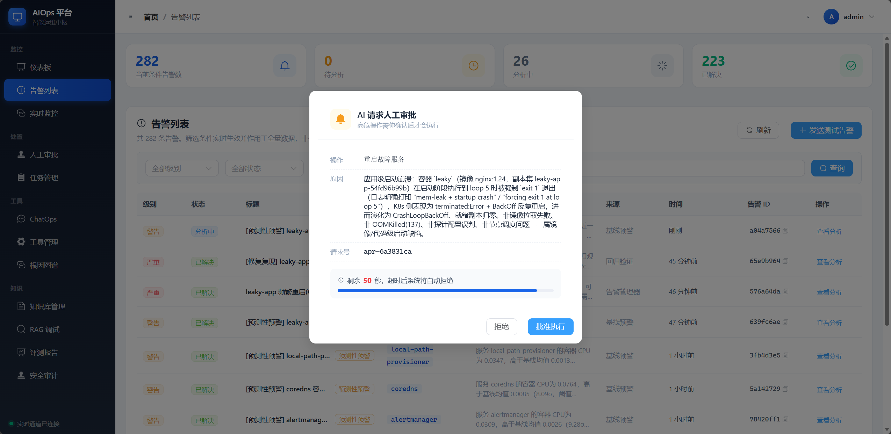
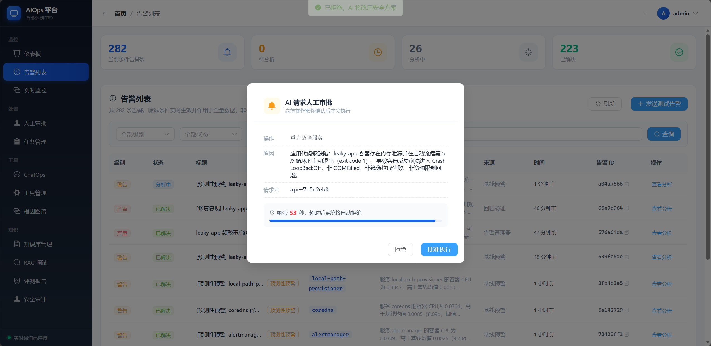
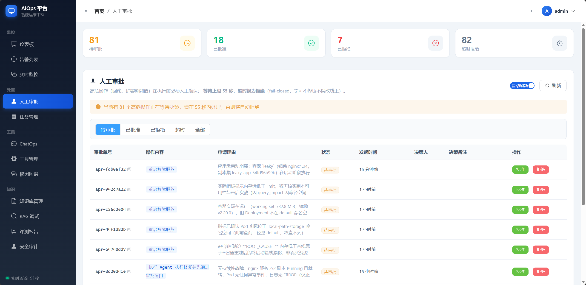
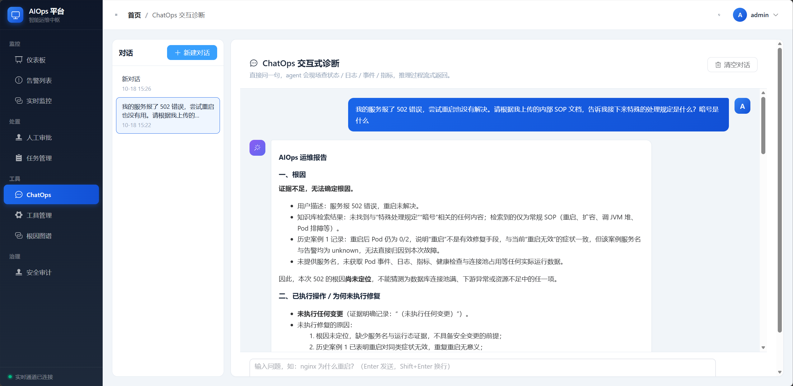
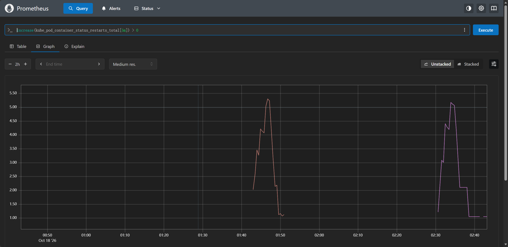

# AIOps 智能运维平台——手动全链路验收指南

> 本指南按“一条告警从 Prometheus 落到 Java，再由 Python LangGraph 分析、审批、执行、报告、入库”的真实路径编写。
> 所有功能都标注了对应源码文件与调用链，方便你对着代码手动跑通后理解项目。
>
> 适用环境：本地 kind 集群 `aiops` + Redis + MySQL + Kafka + Java :8081 + Python :5000 + 前端 :3000。
> 若你的环境端口或密钥不同，以 `ops_agent/.env`、`aiops-agent/.env`、`application.yml` 实际值为准。

---

## 1. 技术栈总览

| 层 | 技术 | 端口 / 入口 | 职责 |
|---|---|---|---|
| 前端 | Vue 3 + Vite + Pinia + Element Plus + ECharts | :3000 | 登录、告警、审批、任务、工具演练、实时监控、审计、根因图谱、ChatOps |
| Java 中枢 | Spring Boot WebFlux + WebClient + Reactor | :8081 | 鉴权、告警接入、降噪、任务调度、工具执行、审批、WebSocket 推送、内置 REST API |
| Python AI 大脑 | FastAPI + LangGraph + LangChain | :5000 | Supervisor 单主图 + 诊断/执行/报告子图、RAG 混合检索、Reflection、定时巡检 |
| 向量检索 | Chroma + DashScope Embedding | 本地目录 `aiops-agent/rag/chroma_db` | SOP 知识库 + 历史案例库双 collection |
| 模型 | DeepSeek 对话/润色/评测 + DashScope embedding/rerank | 外部 API | LLM 推理、Query 润色、Rerank |
| 状态化 | LangGraph SQLite Checkpointer（本地） | `aiops-agent/rag/checkpoints.sqlite` | 审批 interrupt 挂起 / resume 断点续跑 |
| 监控源 | kind + kube-prometheus-stack + Alertmanager | 9090 / 9093 | 真实告警自动进入 Java |

---

## 2. 启动前置检查

按下面顺序启动，否则联调会在某一步直接失败。

### 2.1 依赖探活

```bash
# Java 后端
curl -s http://localhost:8081/actuator/health

# Python AI 大脑
curl -s http://localhost:5000/health

# Redis
docker exec -it redis redis-cli ping

# MySQL（密码按你自己的环境）
mysql -uroot -pmjx123456 -e "select 1"

# Kafka 含 alerts 与工具调用双通道 topic
docker exec -it kafka kafka-topics.sh --bootstrap-server localhost:9092 --list | grep -E 'alerts|agent-tool'

# kind 集群
kubectl get nodes
```

预期：8081 UP、5000 healthy、Redis PONG、MySQL 返回 1、Kafka 含 `alerts` 与 `agent-tool-request` / `agent-tool-result`、节点 Ready。

### 2.2 启动顺序

```bash
# 1. 中间件
docker start redis kafka aiops-control-plane
# MySQL 按你的方式启动（Windows 常用 XAMPP）

# 2. Java（WebFlux 异步中枢）
cd D:/桌面/智能运维项目/ops_agent
MYSQL_PASSWORD=mjx123456 mvn spring-boot:run -DskipTests

# 3. Python AI 大脑
cd D:/桌面/智能运维项目/aiops-agent
.venv/Scripts/python.exe main.py

# 4. 前端
cd D:/桌面/智能运维项目/ops-agent-front
npm run dev
```

对应源码：`ops_agent/src/main/java/com/opsagent/OpsAgentApplication.java`、`aiops-agent/main.py`、`ops-agent-front/package.json`。

### 2.3 拿一个 JWT

```bash
TOKEN=$(curl -s -X POST http://localhost:8081/api/auth/login \
  -H "Content-Type: application/json" \
  -d '{"username":"admin","password":"admin123"}' \
  | python -c "import sys,json;print(json.load(sys.stdin)['data']['token'])")
echo "$TOKEN"
```

对应源码：`ops_agent/src/main/java/com/opsagent/controller/AuthController.java`、`service/UserService.java`。
后续所有需要鉴权的命令都用 `Authorization: Bearer $TOKEN`。

---

## 3. 鉴权与安全防线（先测这条）

这是整个平台的底线。**任何一条不过都不要继续往下测。**

### 3.1 认证

| # | 用例 | 命令 | 预期 |
|---|---|---|---|
| 3.1.1 | 正确登录 | 见 2.3 | 200 + token |
| 3.1.2 | 错误密码 | `-d '{"username":"admin","password":"wrong"}'` | 401 |
| 3.1.3 | 无 token | `curl -s -o /dev/null -w "%{http_code}" http://localhost:8081/api/tasks` | 401 |
| 3.1.4 | 伪 token | `-H "Authorization: Bearer abc"` | 401 |

对应源码：`filter/JwtAuthenticationFilter.java`、`WebFluxConfig.java`。

### 3.2 Python 到 Java 的内部回调令牌

```bash
# 无内部 token
curl -s -o /dev/null -w "%{http_code}" -X POST http://localhost:8081/api/agent/callback/step \
  -H "Content-Type: application/json" -d '{}'

# 带错 token
... -H "X-Internal-Token: wrong" ...

# 带正确 token（以你的 application.yml 为准）
... -H "X-Internal-Token: dev-internal-token" ...
```

预期：无/错 token 为 401，正确 token 为 200。
对应源码：`controller/AgentCallbackController.java`、`service/AgentCallbackService.java`。

> 注：工具执行默认走 Kafka（`agent-tool-request` / `agent-tool-result`），HTTP 回调接口作为降级通道保留；Kafka 通道不依赖 X-Internal-Token，但 Java 侧仍复用工具白名单/审计/审批防线。

### 3.3 Alertmanager Webhook 防线

```bash
curl -s -o /dev/null -w "%{http_code}" -X POST http://localhost:8081/api/alerts/webhook \
  -H "Content-Type: application/json" \
  -H "X-Webhook-Token: dev-webhook-token" \
  -d '{"version":"4","status":"firing","alerts":[]}'
```

预期：202。
对应源码：`controller/AlertWebhookController.java`、`service/AlertWebhookService.java`。

---

## 4. 核心闭环：真实告警 → LangGraph 分析 → 报告

这是平台的主链路，建议按顺序逐步验证。

### 4.1 Webhook 注入一条告警

```bash
curl -s -X POST http://localhost:8081/api/alerts/webhook \
  -H "Content-Type: application/json" \
  -H "X-Webhook-Token: dev-webhook-token" \
  -d '{
    "version":"4","status":"firing","receiver":"aiops",
    "alerts":[{
      "status":"firing",
      "labels":{
        "alertname":"DemoAppCrashLoop",
        "severity":"critical",
        "service":"leaky-app",
        "instance":"10.99.88.77",
        "namespace":"default"
      },
      "annotations":{
        "summary":"DemoAppCrashLoop",
        "description":"leaky-app 持续 CrashLoopBackOff，需分析根因"
      },
      "startsAt":"2026-10-17T10:00:00Z"
    }]
  }'
```

预期：HTTP 202，随后 `/api/tasks` 能查到任务。

链路源码：

- 入口 `controller/AlertWebhookController.java` → `service/AlertWebhookService.java`
- 落库 `service/AlertIngestionService.java` 的 `processAlert`
- 创建任务 `service/TaskSchedulerService.java`
- 通知 Python `service/AgentCallbackService.java` 的 `notifyAgent`

### 4.2 看 Java 侧任务状态变化

```bash
curl -s -H "Authorization: Bearer $TOKEN" "http://localhost:8081/api/tasks?page=1&size=5"
```

预期：任务状态从 `PENDING` → `RUNNING` → `SUCCESS`，关联告警从 `PENDING` → `ANALYZING` → `RESOLVED`。
对应源码：`TaskController.java`、`TaskSchedulerService.java`、`AgentCallbackService.taskComplete`。

### 4.3 看 Python LangGraph 在跑什么

Python :5000 的 stdout 会输出每一步。对应源码：

- 任务受理：`aiops-agent/main.py` 的 `/api/agent/start`
- 后台执行：`aiops-agent/services/task_runner.py` 的 `submit`
- 主图：`aiops-agent/agents/graph/graph.py` 的 `build_graph` / `run_agent_for_alert`
- 图结构：`supervisor_node` → 诊断子图/并行 Pod 诊断 → 执行子图（写操作先审批）→ 报告子图 → Reflection → 回传 Java

```bash
# 手动触发一次全服务健康巡检（不走告警，验证同一张图）
curl -s -X POST http://localhost:8081/api/agent/trigger_health_check \
  -H "Authorization: Bearer $TOKEN"
```

### 4.4 看最终报告



*Prometheus/Alertmanager 真实告警进入平台后的待处理状态。*

```bash
curl -s -H "Authorization: Bearer $TOKEN" "http://localhost:8081/api/tasks/{taskId}"
```

报告里应至少包含：根因、影响面、是否执行了变更、验证结论。若 report 诚实标注“日志通道不可用”或“未执行变更”，说明 Reflection 生效，不是 bug。
对应源码：`agents/graph/reporter.py`、`agents/reflection.py`、`AgentCallbackService.taskComplete`。

### 4.5 ChatOps 流式对话（同一套图）

```bash
curl -N -s -X POST http://localhost:8081/api/chatops/stream \
  -H "Authorization: Bearer $TOKEN" -H "Content-Type: application/json" \
  -d '{"message":"为什么 leaky-app 一直在重启？","sessionId":"chat-test-001"}'
```

预期：SSE 事件流，包含 `type=final`，最终给出报告，并以 `type=end` 结束。若上游 429 或图死循环，后端会发送 `type=error` + `type=end`，前端立即退出“正在推理”状态。
对应源码：

- Java 代理 `controller/ChatOpsController.java`
- Python SSE `main.py` 的 `/api/agent/stream` → `run_graph_stream`
- 前端 `views/ChatOps.vue`（SSE 解析 `content` / `data`，错误友好提示）

### 4.6 ChatOps 多会话（类似 DeepSeek 网页版）

```bash
# 新建会话
curl -s -X POST http://localhost:8081/api/chatops/sessions \
  -H "Authorization: Bearer $TOKEN"

# 当前用户会话列表
curl -s http://localhost:8081/api/chatops/sessions \
  -H "Authorization: Bearer $TOKEN"

# 恢复某个会话历史（Java 校验用户归属，Python Checkpointer 返回消息）
curl -s http://localhost:8081/api/chatops/sessions/{sessionId} \
  -H "Authorization: Bearer $TOKEN"
```

预期：会话列表按更新时间倒序；切到旧会话后前端能恢复用户问题与助手报告；同一 `sessionId` 继续提问时，Python 用其作为 LangGraph `thread_id`，跨页面/刷新保留上下文。
对应源码：

- Java `ChatOpsController.java` + `ChatSessionService.java`（Redis 会话索引）
- Python `main.py` / `agents/graph/graph.py`（Checkpointer × `session_id`）

---

## 5. 用户行为闭环：ChatOps 文本 → Java 代理 → Python

这是前端对话页面的核心路径，适合你手动在浏览器里跑一遍：

```text
浏览器 http://localhost:3000/login
登录 admin / admin123
左侧菜单 → ChatOps
左侧“新建对话”创建会话
输入「nginx 为什么重启？」并发送
刷新页面，右侧自动恢复最近会话的历史消息
```

技术上等于 `/api/chatops/stream → main.py /api/agent/stream → LangGraph 图 → Java 回调工具 → SSE 回前端`。
前端源码：`views/ChatOps.vue`、`api/chatops.js`。

---

## 6. 审批闭环（高危写操作，重点验证）

平台的高危操作（回滚、流量切换、驱逐 Pod、节点排空、调整连接池/探针等）在执行前必须人工审批。
实现上不是 Java 线程轮询，而是 **LangGraph interrupt() + Checkpointer 挂起整张图**，Java 审批后调用 Python resume 续跑。

### 6.1 制造一条写操作审批

推荐两条路：

1. 在前端 `工具演练` 页执行 `config_rollback` / `traffic_switch` / `pod_evict` 等，人工确认弹窗。
2. 直接调用 Java 审批接口，模拟“Python 已挂起”的记录并恢复。

```bash
# 模拟 Python 创建审批单（requestId 必须与 taskId/上下文一致，先用占位）
curl -s -X POST http://localhost:8081/api/tools/execute \
  -H "Authorization: Bearer $TOKEN" -H "Content-Type: application/json" \
  -d '{"toolName":"request_human_approval","parameters":{"operation":"rollback leaky-app","reason":"验收测试","contextId":"accept-approval-001"}}'
```

预期：返回 `pending=true` 与 `requestId`，同时前端收到审批弹窗（WebSocket 广播）。

### 6.2 查看待审批列表

```bash
curl -s -H "Authorization: Bearer $TOKEN" "http://localhost:8081/api/approvals?status=PENDING"
```

预期：能看到 requestId、PENDING、operation。
对应源码：`controller/ApprovalController.java`、`service/ApprovalService.java`。

### 6.3 提交审批决定

```bash
curl -s -X POST http://localhost:8081/api/approvals/{requestId}/decision \
  -H "Authorization: Bearer $TOKEN" -H "Content-Type: application/json" \
  -d '{"approved":true,"note":"验收通过"}'
```

预期：返回 APPROVED；随后 Java 调 Python `/api/agent/resume`，审批单状态变为终态。
以下任一情况都不该发生：

- 重复点击同一审批单 → 400（不允许重复审批）
- Java 无 token 时 Python 返回 401（`X-Internal-Token` 校验）

对应源码：

- 审批决定：`service/ApprovalService.decide`
- Python 恢复：`main.py /api/agent/resume` → `agents/graph/graph.py resume_graph`
- 恢复校验：`resume_graph` 里比对挂起 interrupt 的 requestId

### 6.4 前端要点

审批弹窗从 `store/websocket.js` 的常驻连接接收 `APPROVAL_PENDING` / `APPROVAL_DECIDED`，打开任意页面都能收到，不需要停在任务页。
如果发现审批 55 秒自动消失，就是 WebSocket 没有常驻或 Java 没广播，这是平台明确要求修掉的行为回归。


*真实故障进入人工审批后的待审批页面。*



*拒绝审批后保持 fail-closed，不执行任何写操作。*



*告警风暴与审批超时场景下的安全兜底表现。*

---

## 7. 工具白名单与边界（安全性核心）

### 7.1 查看白名单

```bash
curl -s -H "Authorization: Bearer $TOKEN" http://localhost:8081/api/tools/agent-exposed
curl -s -H "Authorization: Bearer $TOKEN" http://localhost:8081/api/tools/list
```

预期：

- `agent-exposed` **不含** `generic_command`
- `list` 里有 `generic_command`，但 `agentExposed=false`

对应源码：`service/ToolRegistryService.java` 的 `execute` 白名单判断；配置在 `ops_agent/src/main/resources/application.yml` 的 `opsagent.tools.agent-exposed`。

### 7.2 硬钳制测试

```bash
# 扩容越界 9999
curl -s -X POST http://localhost:8081/api/tools/execute \
  -H "Authorization: Bearer $TOKEN" -H "Content-Type: application/json" \
  -d '{"toolName":"scale_up","parameters":{"deployment":"nginx","replicas":9999}}'
```

预期：拒绝，`message` 含“必须在 0..50 之间”，且 `durationMs` 极小（说明校验在访问 K8s 之前）。
对应源码：`tool/ScaleUpTool.java`。

### 7.3 手工执行 generic_command（仅人工通道）

```bash
curl -s -X POST http://localhost:8081/api/tools/execute \
  -H "Authorization: Bearer $TOKEN" -H "Content-Type: application/json" \
  -d '{"toolName":"generic_command","parameters":{"command":"echo hello-test"}}'
```

预期：`stdout=hello-test`，说明工具保留但代理不可见。
对应源码：`tool/GenericTool.java`。

### 7.4 只读工具与日志降级

```bash
curl -s -X POST http://localhost:8081/api/tools/execute \
  -H "Authorization: Bearer $TOKEN" -H "Content-Type: application/json" \
  -d '{"toolName":"query_log","parameters":{"service":"leaky-app"}}'
```

预期：SSH 不通时返回 `source=k8s-pod-logs`（K8s Pod 日志降级），而不是直接失败。
对应源码：`tool/QueryLogTool.java`。

---

## 8. RAG 知识库与检索链路

### 8.1 查看知识库

```bash
curl -s -H "Authorization: Bearer $TOKEN" http://localhost:8081/api/rag/knowledge/overview
curl -s -H "Authorization: Bearer $TOKEN" http://localhost:8081/api/rag/knowledge/documents
```

对应源码：

- Java 代理 `controller/RagProxyController.java`
- Python `main.py /api/rag/knowledge/*` → `rag/rag_modules` 延迟导入
- 元数据/审计 `rag/knowledge_meta.py`

### 8.2 上传一份 SOP 文档

```bash
curl -s -X POST http://localhost:8081/api/rag/knowledge/upload \
  -H "Authorization: Bearer $TOKEN" -H "Content-Type: application/json" \
  -d '{"content":"nginx 503 处理步骤：1.查 Pod 事件 2.看日志 3.重启 4.验证","filename":"nginx-503-sop.txt","operator":"manual-test"}'
```

预期：返回 `ok:true` 与 `chunks>0`；重复上传返回 `duplicate:true`。
对应源码：`rag/knowledge_manager.py` 的 `upload_document`，内部走「hash 去重 → 切片 → Chroma upsert → 审计」。

### 8.3 RAG 检索调试

```bash
curl -s -X POST http://localhost:8081/api/rag/debug?query=%E9%87%8D%E5%90%AF%20nginx%20%E6%B5%81%E7%A8%8B&k=3 \
  -H "Authorization: Bearer $TOKEN"
```

预期：返回 BM25 / 向量 / RRF / Rerank 各阶段数量与耗时，以及最终 TopK。
对应源码：`rag/vector_store.py` 的 `hybrid_search`、`_bm25_search`、`_vector_search`、`_rrf_fuse`、`_rerank`。

### 8.4 ChatOps 里看到 RAG 生效



*ChatOps 中模型限流/检索失败的可见降级提示。*

让 agent 搜索“nginx 重启流程”，正常时报告里应出现知识库参考或历史案例。若没有，检查：

- `DASHSCOPE_API_KEY` 是否配置
- Chroma 是否构建过（`aiops-agent/rag/chroma_db` 存在）
- 检索日志是否有降级提示

对应源码：`agents/graph/tool_sets.py` 的 `search_knowledge_base`。

---

## 9. 集群状态、基线、拓扑、影响面

### 9.1 只读接口



*底层指标重启波峰，可用于根因分析中的异常水位确认。*

```bash
curl -s -H "Authorization: Bearer $TOKEN" http://localhost:8081/api/cluster/status
curl -s -H "Authorization: Bearer $TOKEN" http://localhost:8081/api/cluster/metrics
curl -s -H "Authorization: Bearer $TOKEN" http://localhost:8081/api/cluster/baseline
curl -s -H "Authorization: Bearer $TOKEN" "http://localhost:8081/api/cluster/topology?deployment=leaky-app"
curl -s -H "Authorization: Bearer $TOKEN" "http://localhost:8081/api/cluster/impact?deployment=leaky-app"
```

对应源码：`controller/ClusterStatusController.java`、`service/ClusterStatusService.java`、`service/TopologyService.java`、`service/ImpactAnalysisService.java`。

### 9.2 根因图谱与相似故障

```bash
curl -s -H "Authorization: Bearer $TOKEN" "http://localhost:8081/api/intelligence/root-cause-graph?taskId=xxx"
curl -s -H "Authorization: Bearer $TOKEN" "http://localhost:8081/api/intelligence/similar-tasks?service=leaky-app"
```

对应源码：`controller/IntelligenceController.java`、`service/RootCauseGraphService.java`。

---

## 10. 回归验证与评测

### 10.1 回归验证

修复任务 `SUCCESS` 后会进入 5 分钟观察期，连续 2 次失败会改判 `REGRESSED` 并重新触发分析。手动验证比较耗时，可缩小配置后观察：

```yaml
# ops_agent/src/main/resources/application.yml
opsagent:
  recovery:
    observe-minutes: 1
    interval-seconds: 10
```

对应源码：`service/RecoveryVerificationService.java`、`AgentCallbackService.scheduleRecoveryVerification`。

### 10.2 六维度评测

```bash
cd D:/桌面/智能运维项目/aiops-agent
.venv/Scripts/python.exe evaluate_agent.py --size 10
.venv/Scripts/python.exe evaluate_agent.py --self-test
```

对应源码：`evaluate_agent.py`。

### 10.3 RAG 分层评测

```bash
# 直接 Python
curl -s -X POST http://localhost:5000/api/rag/evaluate \
  -H "Content-Type: application/json" -d '{"dataset":[],"llm_judge":false,"k":3}'

# 经 Java 代理
curl -s -X POST http://localhost:8081/api/rag/evaluate \
  -H "Authorization: Bearer $TOKEN" -H "Content-Type: application/json" \
  -d '{"dataset":[],"llm_judge":false,"k":3}'
```

预期：返回 Context Precision/Recall、NDCG、Recall@K、Faithfulness、Answer Relevance 等指标。
对应源码：`rag/eval_metrics.py`。

### 10.4 混沌/对抗评测

```bash
curl -s -H "Authorization: Bearer $TOKEN" http://localhost:8081/api/chaos/run
curl -s -H "Authorization: Bearer $TOKEN" http://localhost:8081/api/chaos/adversarial
```

对应源码：`rag/chaos_metrics.py`。

---

## 11. 前端页面可用性

| 页面 | 路由 | 要点 |
|---|---|---|
| 登录 | `/login` | JWT 保存到 localStorage |
| 仪表板 | `/dashboard` | 集群卡片、基线偏离、告警统计 |
| 告警 | `/alerts` | 列表、状态、影响面 |
| 审批 | `/approvals` | 待审批列表、决策、WebSocket 刷新 |
| 任务 | `/tasks` | 实时步骤推送、REGRESSED 状态 |
| 工具 | `/tools` | 白名单渲染、允许手工 generic_command |
| 实时监控 | `/realtime` | WebSocket 实时流 |
| ChatOps | `/chatops` | 对话流 |
| 审计 | `/audit` | 登录/告警/工具/审批回放 |
| 根因 | `/root-cause` | 关系图谱 |

对应源码：`ops-agent-front/src/router/index.js`、`views/*.vue`、`components/Layout.vue`。
其中实时推送的常驻连接逻辑在 `store/websocket.js`。

---

## 12. 全链路核对点（建议边跑边打勾）

- [ ] Java :8081 health UP
- [ ] Python :5000 health healthy
- [ ] 前端 :3000 登录成功
- [ ] 无 token 访问 `/api/tasks` = 401
- [ ] 错误 Webhook token = 401；正确 token = 202
- [ ] Webhook 注入 `leaky-app` 告警 → 任务出现
- [ ] 任务最终 SUCCESS，告警 RESOLVED
- [ ] ChatOps 能流式输出最终报告
- [ ] 工具白名单不含 `generic_command`
- [ ] `scale_up replicas=9999` 被硬钳制拒绝
- [ ] `query_log` SSH 失败时走 K8s Pod 日志
- [ ] 写操作出现审批单且可随 WebSocket 弹窗
- [ ] 审批 APPROVED 后任务继续到 SUCCESS
- [ ] 审批单重复决定被拒绝
- [ ] RAG 上传文档后检索命中
- [ ] `/api/rag/debug` 返回各阶段计数
- [ ] `/api/cluster/status` / topology / impact 正常
- [ ] 评测与混沌接口可返回指标

---

## 13. 项目不合理点评估

结合上面的代码与链路，我认为存在以下值得改进的地方，按重要程度排序。

### 13.1 直接可改的低风险问题

- **Spring Boot 的 `.env` 与密码硬编码风险**  
  `ops_agent/.env` 存在真实密码（`mjx123456`），`README.md` 和测试文档也直接写明文。仓库根 `.gitignore` 已忽略 `.env`，但 IDE 运行和文档习惯容易泄露。建议引入 `spring-boot-configuration-processor` + 外部密钥管理，至少把文档里的默认密码改成占位。

- **`config.py` 混杂两种模型路由，成本与可用性耦合**  
  主 LLM 走 DeepSeek，Reflection/Query Rewrite 默认走 DashScope/Qwen，但 `RERANK_MODEL` 的 API Key 与主 LLM 共用 Scoped 配置，一旦主模型厂商调价/下线，评估链路也会跟着抖。README 也把这件事列为 LiteLLM 规划，建议尽快落地。

- **`ApprovalService` 仍保留 55 秒超时概念**  
  新实现已不阻塞线程，但注解里 `wait-timeout:55` 仍存在，且 `createAndAwait` 返回 `pending` 后不会真正等待。这个兼容字段会误导后来者，建议删除或明确标注“仅供前端展示”。

- **`evaluate_agent.py` 没有集成到 CI**  
  它很适合做回归网关，但当前只在本地手动跑。建议在 GitHub Actions 里增加一个非集群模式的 pydoc/打分冒烟。

### 13.2 中等问题（会影响稳定性和维护性）

- **`aiops-agent/rag/checkpoints.sqlite` 是 8MB+ 运行态数据且已出现在工作区未跟踪列表**  
  `.gitignore` 已忽略 `.sqlite`，但本地反复跑会导致该文件无限增长。建议定期清理或换 Redis Checkpointer，并把 SQLite 路径明确设为 `/tmp`/一次性目录。

- **前端没有测试框架**  
  `package.json` 只有 `dev/build/preview`。WebSocket、登录态、审批弹窗这三个最核心的交互完全没有自动测试，回归全靠人工。建议至少给 `store/websocket.js` 和 `api/request.js` 加 Vitest。

- **Java 的 `executeTool()` 对 restore / scale / rollback 没有显式打印参数内容**  
  审计只记录 toolName + message，参数细节（如 `replicas`、`service`）没有完整落库。出事故时追“到底改成了什么”需要靠 K8s 事件反推。建议把 `request.getParameters()` JSON 序列化进审计明细。

- **仓库主干直接跑在 main，且未提交的改动非常多**  
  当前 git status 显示大量源码修改和新文件未提交。未来回滚、PR 对比、团队协作都很难区分哪些是本次迭代、哪些是临时联调。建议尽快按功能拆 commit，不要把运行期调试产出混进代码提交。

### 13.3 架构上最值得先动手的两件事

1. **把工具调用链真正跑通 Kafka 并扩展事件类型**  
   当前已落地 Kafka 事件驱动（`agent-tool-request` / `agent-tool-result`）与 HTTP 回调双通道兼容，Python 默认 `CALLBACK_MODE=kafka`。下一步继续扩展事件类型（任务状态、步骤流、审批事件），统一消息契约并做消息幂等/死信队列，彻底减少 HTTP 往返。

2. **把 RAG 案例库的写入和检索解耦**  
   `case_store.py` 在每次成功诊断后同步 embedding 进 Chroma，LLM 报告一长就容易慢，而且 embedding 失败会拖慢收尾。建议改成异步任务：Java 或 Python 后台线程消费 `case_save` 队列，失败重试，不阻塞报告回传。

---

## 14. 建议的下一步

- 按本节检查表跑完一遍，把每次结果记到 `docs/测试清单.md`
- 如果哪一步和预期不符，先看关联源码和 Python/Java 日志，再决定是环境问题还是代码问题
- 提交前先确认没有把 `.env`、`checkpoints.sqlite`、`chroma_db`、`node_modules`、`target` 这类运行态文件推到仓库

这份指南希望做到“照着命令能跑通，跑不通时能顺着代码找到根因”。